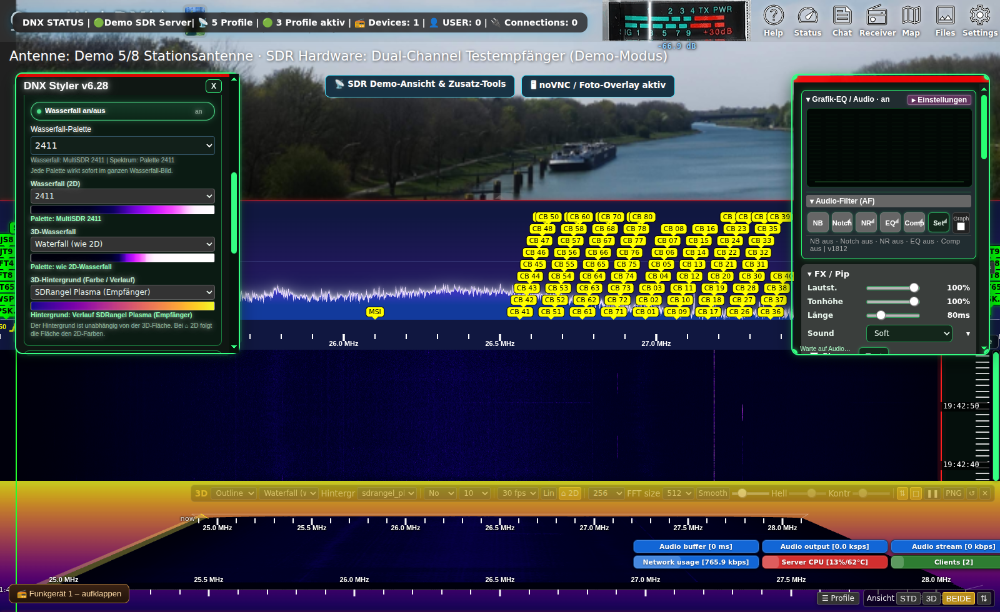
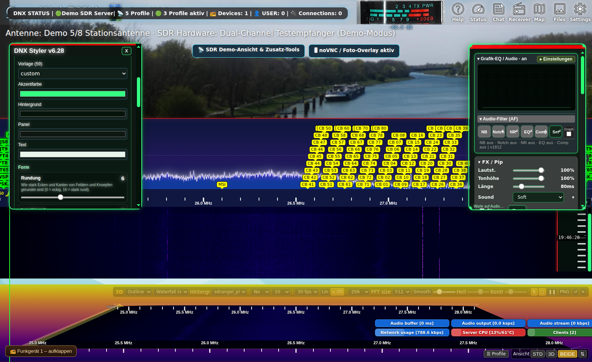
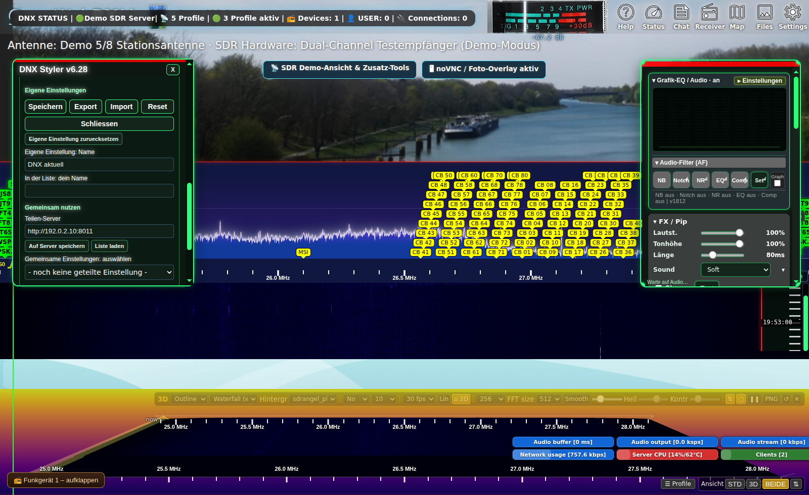
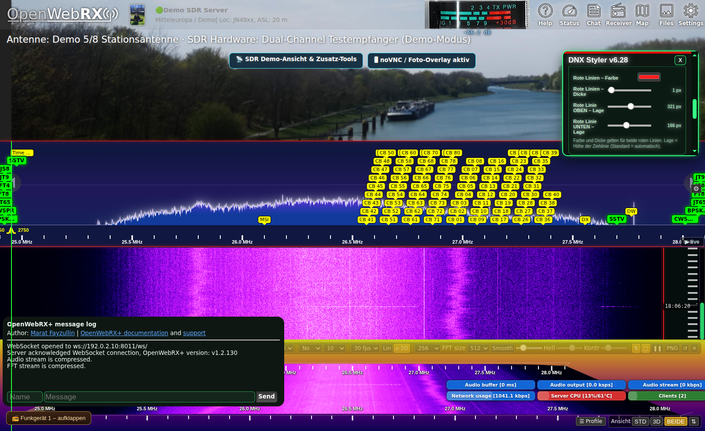
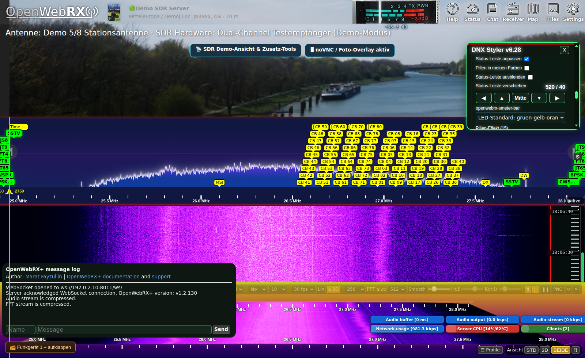

# DNX Styler (`v3.15`)

<!-- DNX-DISCLAIMER-START -->
> **Wichtiger Hinweis / Vollständige Distanzierung (Hobby-Mod-Mode)**
>
> - **Vollständige Distanzierung:** Ich distanziere mich in jeder Hinsicht vollständig vom Projekt **OpenWebRX / OpenWebRX+** sowie dessen Entwicklern und Betreibern. Es besteht keinerlei Verbindung, Zusammenarbeit, Prüfung, Befürwortung oder Partnerschaft.
> - **Keine öffentlichen/offiziellen OpenWebRX-Plugins (nur Mod-Mode):** Bei diesem Projekt handelt es sich ausdrücklich **nicht** um ein öffentliches oder offizielles Plugin von OpenWebRX, sondern ausschließlich um einen privaten, inoffiziellen **Mod-Mode** (Eigenmodifikation).
> - **Warum bewusst kein reines Browser-JavaScript (Mod-Mode-Architektur):** Viele Funktionen (z. B. serverseitige Speicherung, Konten-/Rollenverwaltung, Profil-Synchronisation, VNC-/websockify-Brücken, geschützte Schnittstellen, Docker-/Systemintegration und stabile UI-Anpassungen) lassen sich sauber und sicher nicht allein über simples Client-JavaScript umsetzen, ohne den OpenWebRX-Kern umzubauen oder Browsergrenzen zu umgehen. Deshalb setzt dieses Projekt bewusst auf getrennte Begleitmodule, Shell-Installer und Dienste im **Mod-Mode** statt alles künstlich in reines JavaScript zu pressen.
> - **Kein öffentlicher Support & keine Haftung:** Es gibt **keinen öffentlichen Support**, keine Garantie und keine Haftung. Nutzung, Installation und Anpassung erfolgen vollständig auf eigene Gefahr (immer vorher Backups anlegen und zunächst im eigenen Testsystem prüfen).
> - **Reines Hobbyprojekt – frei nutzbar, änderbar & verbreitbar:** Dieses Projekt entsteht ausschließlich aus reinem Hobby und Interesse am gemeinsamen Funk-/SDR-Hobby. Es steht ausdrücklich frei zur Verfügung und darf frei genutzt, weiterverbreitet, verändert und verbessert werden.
<!-- DNX-DISCLAIMER-END -->

> **Important Notice / Full Disassociation (Hobby Mod-Mode Only)**
>
> - **Full Disassociation:** I completely disassociate myself from **OpenWebRX / OpenWebRX+** and its developers/maintainers. There is no affiliation, endorsement, review, or partnership of any kind.
> - **No Official/Public OpenWebRX Plugins (Mod-Mode Only):** These files are **not** official or public OpenWebRX plugins, but purely unofficial hobby modifications (*mod-mode*).
> - **Why Not Everything in Pure Browser JavaScript:** Many features (server-side persistence, account/role management, profile syncing, VNC/websockify bridges, protected endpoints, and Docker/host integration) cannot be implemented cleanly or reliably in client-side JavaScript alone without modifying the OpenWebRX core or hitting browser/security limits. That is why this project intentionally uses separate companion scripts, services, and *mod-mode* hooks rather than forcing everything into pure JS.
> - **No Public Support & No Warranty:** There is **no public support**, no warranty, and no liability. Use entirely at your own risk (always create backups and verify on a test system first).
> - **Pure Hobby Project — Free to Use, Modify & Redistribute:** Created solely out of personal hobby interest in the radio/SDR hobby; freely available to use, share, modify, and improve.

<!-- DNX-PREVIEW-START -->
## Live-Vorschau & Galerie / Live Preview (`DNX Styler`)



| Ansicht / View | Beschreibung / Description | Screenshot |
|---|---|---|
| **Wasserfall & 3D (Vorlage)** | 2D-/3D-Paletten (`2411`), 3D-Hintergrund (`SDRangel Plasma`), `Grafik-EQ` & Gesamtansicht |  |
| **Receiver-Darstellung** | 59 Vorlagen, Akzentfarben, Rundung, Leuchtrand & Puls-Effekt |  |
| **Spektrum & Pegel** | Spektrum-Farbe/Palette/Hintergrund, Raster-Deckkraft & Wasserfall-Pegel |  |
| **Werkzeuge an / aus** | Einzel-Schalter für Audio-Filter (AF), DX-Cluster, Funkgerät 1–3, Wasserfall, 2D/3D, Linien & S-Meter |  |
| **Speichern & Teilen-Vorlagen** | Eigene Einstellungen speichern/exportieren sowie gemeinsamer Preset-Server (`styler_share.py`) |  |
| **3D-Wasserfall Integration** | Echtzeit-WebGL-3D-Wasserfall im Zusammenspiel mit dem Styler-Design |  |
| **S-Meter (Nadel) & Receiver** | Wählbares S-Meter-Design, 7 LCD-Farben & freie Positionssteuerung |  |
| **Spektrum-Zahnrad (`⚙`)** | Direktes Spektrum-Paletten-, Hintergrund-, Helligkeits-, Kontrast-, Sättigungs- & Raster-Menü |  |
| **Rote Linien & Popover** | Interaktive rote Ziehlinien oben/unten mit Live-Höhenänderung und Dicke-/Farbwahl |  |
| **Statusleiste verschieben** | Frei verschiebbare Receiver-/Profil-/Status-Leiste per Ziehen (`Alt`/Drag) & Reset per Doppelklick |  |
<!-- DNX-PREVIEW-END -->

Umfangreiches Design-, Theme-, Wasserfall-/Spektrum-Paletten-, S-Meter- und Bedienoberflächen-Overlay für OpenWebRX+ (`v3.15` / `dnx_styler.js v6.10`).

Comprehensive design, theme, waterfall/spectrum palette, S-meter, resize-line and UI overlay suite for OpenWebRX+ (`v3.15` / `dnx_styler.js v6.10`).

## Neu in v3.15 & Aktuelle Highlights / Highlights

- **`dnx_styler.js` (`v6.10`) inklusive abgestimmter `dnx_stand.txt` (`v6.10 1001775`):**
  - 3-Geräte-Umschalterleiste (`Funkgerät 1`, `Funkgerät 2`, `Funkgerät 3`) mit direktem Einzel-Schalter und `1 ⇄ 2 ⇄ 3`-Mausradtausch.
  - Wasserfall-/Spektrum-Grenzen (`boden`, `deckel`, `autoFit`) auch serverseitig über `styler_share.py` (`saeubern_std()`) sauber unterstützt.
  - Bereinigte S-Meter-Bezeichnungen (`LCD-Stufenskala`, `LCD-Bogenskala`) und entfernte interne LAN-Kommentare.
  - Spektrum-Zahnrad (`⚙`), rote Ziehlinien für Bereichshöhen sowie verschiebbare Status-/Profilleiste.
- **`styler_share.py`:** Theme-/Standard-Verteilerdienst ohne fest verdrahteten Home-Pfad (nutzt `DNX_SHARE_DIR` oder `~/.dnx`).

## Dateien im Paket / Package Contents

| Datei | Ziel / Target | Zweck / Purpose |
|---|---|---|
| `dnx_styler.js` | `…/htdocs/plugins/receiver/dnx_styler.js` | Kompletter DNX Styler (`v6.10`) / Full DNX Styler overlay |
| `dnx_stand.txt` | `…/htdocs/plugins/receiver/dnx_stand.txt` | Versions-/Größenstempel (`v6.10 1001775`) |
| `styler_share.py` | Host-Dienst (optional, Port `8098`) | Globales Standard-Profil & Teilen / Global preset share server |
| `docs/` | — | 10 Funktionsscreenshots (`1600×980`) |
| `LICENSE`, `SHA256SUMS.txt` | — | MIT-Lizenz & Prüfsummen / License & checksums |

## Einbau / Installation

```bash
cp dnx_styler.js dnx_stand.txt /pfad/zu/htdocs/plugins/receiver/
# Optional: Theme-Share-Server starten / Optionally start share service:
python3 styler_share.py
sha256sum -c SHA256SUMS.txt
```

Vorher Backup anlegen (`cp dnx_styler.js dnx_styler.js.bak-<datum>`). Danach Browser mit `Strg+F5` neu laden.

