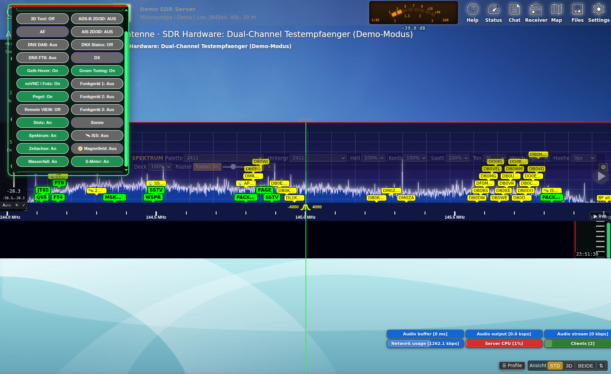
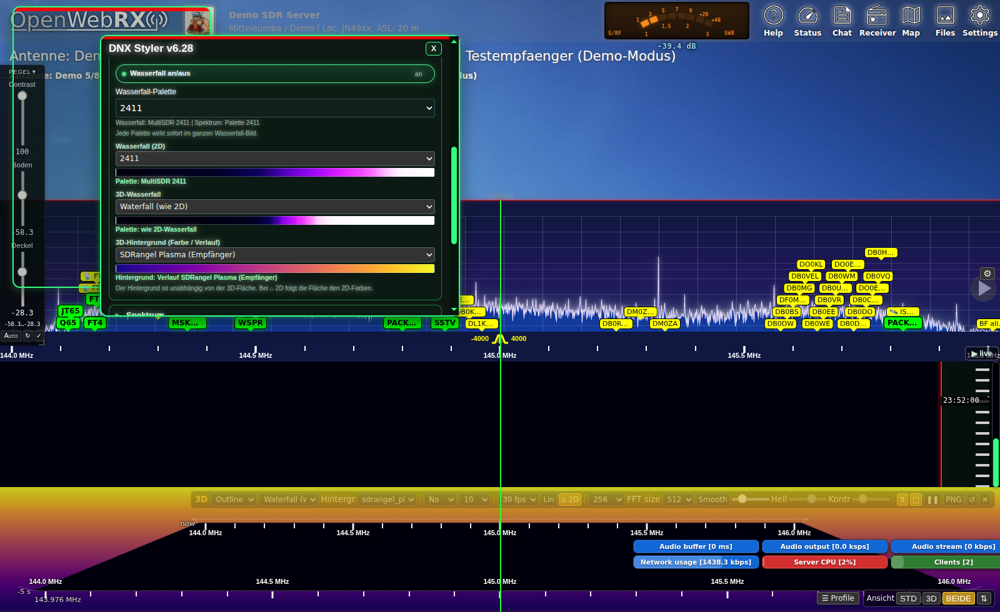
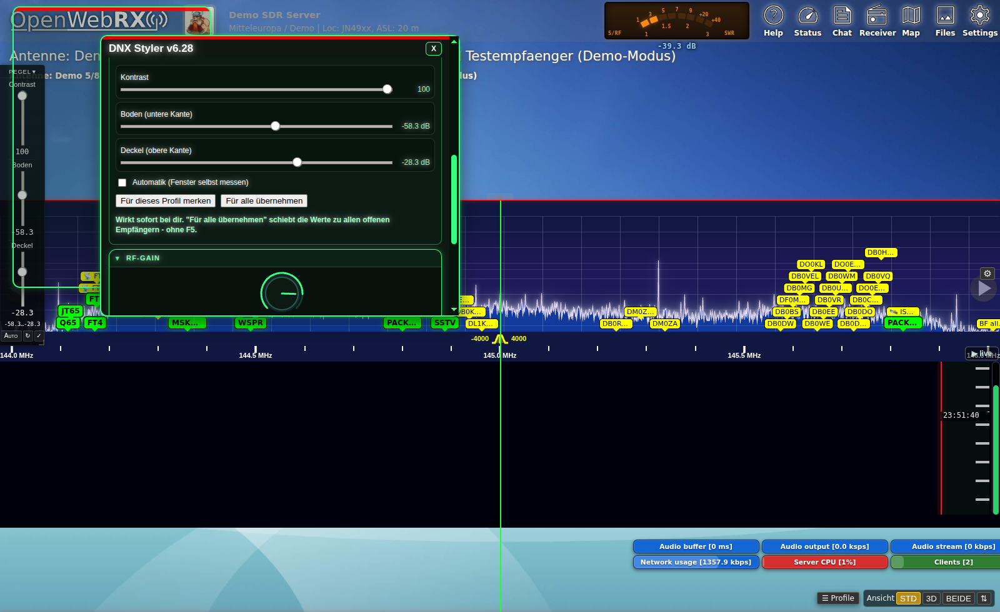
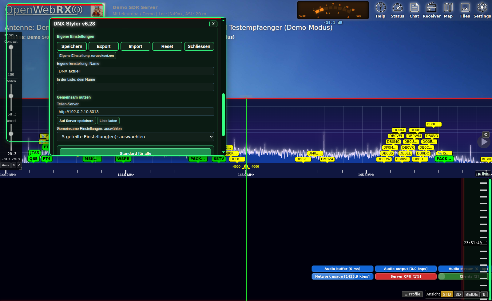
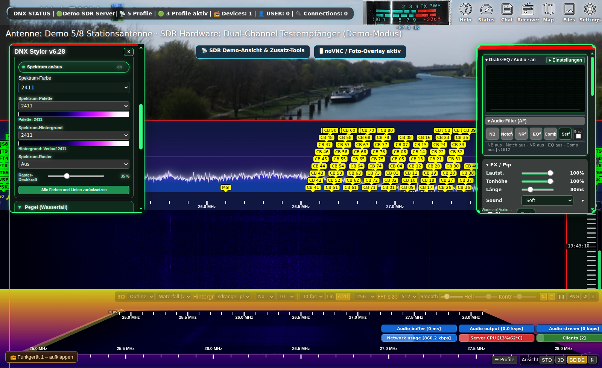
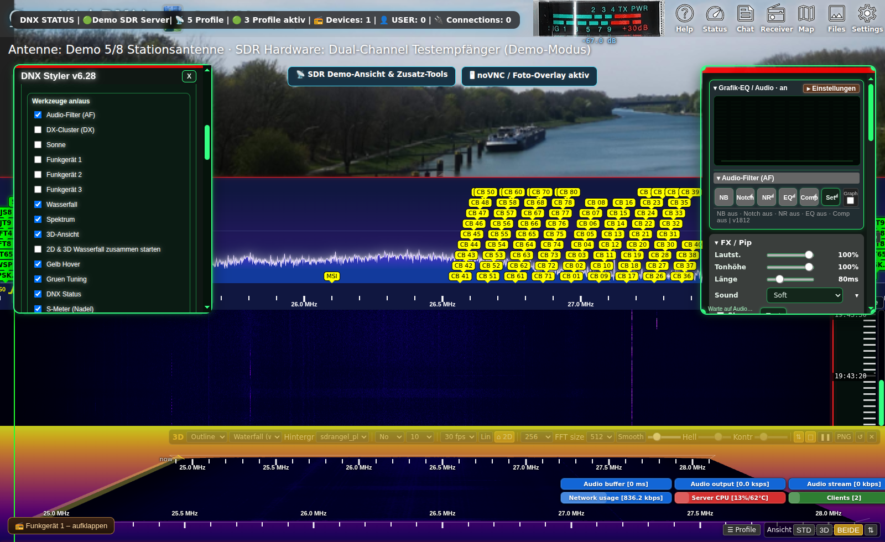
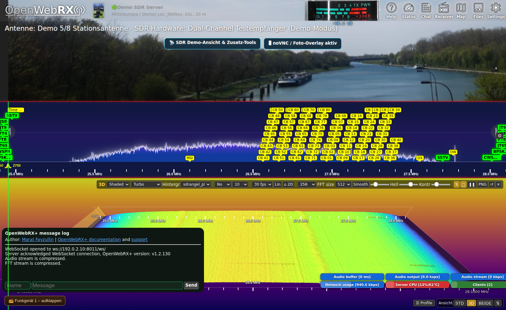
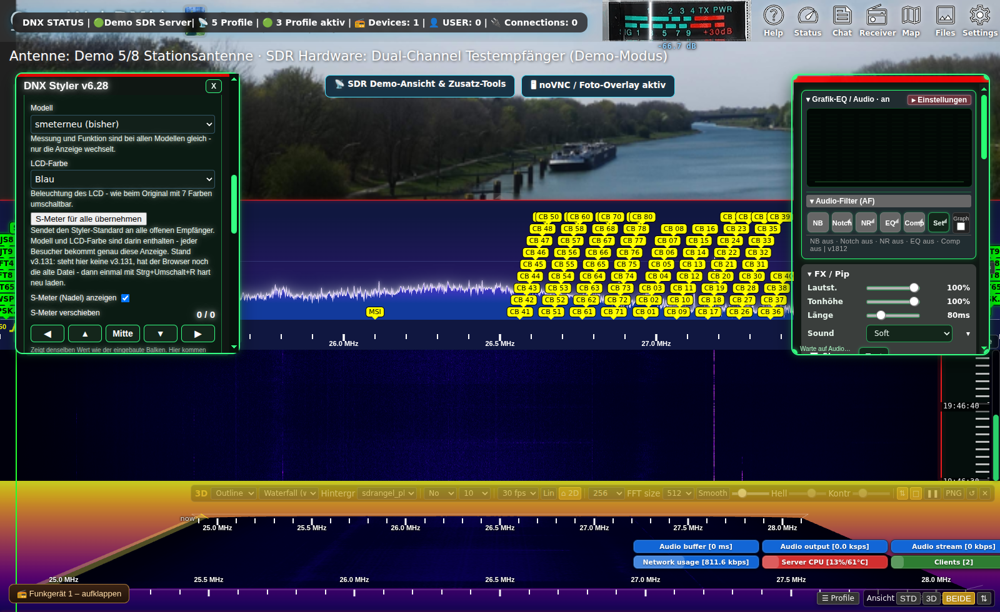

# DNX Styler (`v3.17` / UI `v6.28`)

<!-- DNX-DISCLAIMER-START -->
> **Wichtiger Hinweis / Vollständige Distanzierung (Hobby-Mod-Mode)**
>
> - **Vollständige Distanzierung:** Ich distanziere mich in jeder Hinsicht vollständig vom Projekt **OpenWebRX / OpenWebRX+** sowie dessen Entwicklern und Betreibern. Es besteht keinerlei Verbindung, Zusammenarbeit, Prüfung, Befürwortung oder Partnerschaft.
> - **Keine öffentlichen/offiziellen OpenWebRX-Plugins (nur Mod-Mode):** Bei diesem Projekt handelt es sich ausdrücklich **nicht** um ein öffentliches oder offizielles Plugin von OpenWebRX, sondern ausschließlich um einen privaten, inoffiziellen **Mod-Mode** (Eigenmodifikation).
> - **Warum bewusst kein reines Browser-JavaScript (Mod-Mode-Architektur):** Viele Funktionen (z. B. serverseitige Speicherung, Konten-/Rollenverwaltung, Profil-Synchronisation, VNC-/websockify-Brücken, geschützte Schnittstellen, Docker-/Systemintegration und stabile UI-Anpassungen) lassen sich sauber und sicher nicht allein über simples Client-JavaScript umsetzen, ohne den OpenWebRX-Kern umzubauen oder Browsergrenzen zu umgehen. Deshalb setzt dieses Projekt bewusst auf getrennte Begleitmodule, Shell-Installer und Dienste im **Mod-Mode** statt alles künstlich in reines JavaScript zu pressen.
> - **Kein öffentlicher Support & keine Haftung:** Es gibt **keinen öffentlichen Support**, keine Garantie und keine Haftung. Nutzung, Installation und Anpassung erfolgen vollständig auf eigene Gefahr (immer vorher Backups anlegen und zunächst im eigenen Testsystem prüfen).
> - **Reines Hobbyprojekt – frei nutzbar, änderbar & verbreitbar:** Dieses Projekt entsteht ausschließlich aus reinem Hobby und Interesse am gemeinsamen Funk-/SDR-Hobby. Es steht ausdrücklich frei zur Verfügung und darf frei genutzt, weiterverbreitet, verändert und verbessert werden.
<!-- DNX-DISCLAIMER-END -->

> **Important Notice / Full Disassociation (Hobby Mod-Mode Only)**
>
> - **Full Disassociation:** I completely disassociate myself from **OpenWebRX / OpenWebRX+** and its developers/maintainers. There is no affiliation, endorsement, review, or partnership of any kind.
> - **No Official/Public OpenWebRX Plugins (Mod-Mode Only):** These files are **not** official or public OpenWebRX plugins, but purely unofficial hobby modifications (*mod-mode*).
> - **Why Not Everything in Pure Browser JavaScript:** Many features (server-side persistence, account/role management, profile syncing, VNC/websockify bridges, protected endpoints, and Docker/host integration) cannot be implemented cleanly or reliably in client-side JavaScript alone without modifying the OpenWebRX core or hitting browser/security limits. That is why this project intentionally uses separate companion scripts, services, and *mod-mode* hooks rather than forcing everything into pure JS.
> - **No Public Support & No Warranty:** There is **no public support**, no warranty, and no liability. Use entirely at your own risk (always create backups and verify on a test system first).
> - **Pure Hobby Project — Free to Use, Modify & Redistribute:** Created solely out of personal hobby interest in the radio/SDR hobby; freely available to use, share, modify, and improve.

> **Fassungshinweis:** Das Release-Paket trägt die Tag-Version `v3.17`, die UI-Titelleiste zeigt **`DNX Styler v6.28`** (inkl. überarbeiteter Standard-Wasserfallpalette `2511` mit ruhigem Nachtblau am Rauschboden, optionalem `WF-Glättung`-Werkzeugschalter `t_wfglaettung`, Spektrum-/Wasserfall-Entkopplung nach SDR#-Art, kalibriertem dBFS-Spektrum-Raster `#dnx-spek-raster`, `v6.26`-Funktionsblöcken, `v6.27`-3D-Hintergrundschutz und `v6.28`-3D-Sync), inkl. flüssigem 60-FPS-Rendering ohne Main-Thread-Ruckler (1/4-Auflösungs-Glow ohne Vollbild-Downsampling, Dirty-Check im Spektrum, entprellter Seitenleisten- & S-Meter-/Werkzeugreihen-Abgleich), und `dnx_stand.txt` dokumentiert den Prüfsummenstempel `v6.13 1025270`. Siehe auch die Begleitprojekte [`DNX-Pegel`](https://github.com/KanotixPinguin/DNX-Pegel) und [`DNX-WF-Glaettung`](https://github.com/KanotixPinguin/DNX-WF-Glaettung).

---

<!-- DNX-PREVIEW-START -->
## Live-Vorschau & Galerie / Live Preview (`DNX Styler`)


| Ansicht / View | Beschreibung / Description | Screenshot |
|---|---|---|
| **Gesamtarchitektur & Verbindungen** | Zusammenspiel von Browser-UI, Styler-Bridges, 3D-Engine, `waterfall_pro`, Account Control (`:8095/:8096`), Remote VIEW (`:8099`) und `styler_share.py` (`:8098`) |  |
| **Datenflüsse & 4-stufige Speicherung** | Spektrum/Zahnrad/Vergrößerung, 3D-Hintergrund-Sync sowie Browser-, Profil-, Konto- und Server-Persistenz |  |
| **Werkzeugleiste, Spektrum (`⚙`) & Raster** | Receiver-Werkzeugleiste (`Spektrum: An`, `Wasserfall: An`, `3D Tool`, …), ausgeklappte `#dnx-spec-bar`, aktives `Raster: An` & `⚙`-Zahnrad |  |
| **Spektrum-Zahnrad (`⚙`)** | Direktes Spektrum-Paletten-, Hintergrund-, Helligkeits-, Kontrast-, Sättigungs-, Ton-, Weichzeichner-, Höhen- & Deckkraft-Menü |  |
| **Wasserfall & 3D (Vorlage)** | 2D-/3D-Paletten (`2411`), 3D-Hintergrund (`SDRangel Plasma`), `Grafik-EQ` & Gesamtansicht |  |
| **3D-Hintergrund & BEIDE-Split live** | Styler-Block `Wasserfall & 3D` synchronisiert live mit `#dnx3d-toolbar` & WebGL-3D-Split (`BEIDE`) |  |
| **Pegel & Profil-Speicherung** | Styler-Block `Pegel (Wasserfall)` (`Contrast` = nur Wasserfall, `Range` & `Offset` = nur Spektrum, `Automatik`, `Spektrum-Skala`, `Für dieses Profil merken` / `Für alle übernehmen` + `RF-GAIN`) synchron zum `PEGEL`-Seitenpanel |  |
| **Speichern, Teilen & Admin-Standard** | Eigene Einstellungen (`Speichern`, `Export`, `Import`, `Reset`), Server-Liste (`:8098`) & Admin-Button `Standard für alle` |  |
| **Receiver-Darstellung** | `59` Vorlagen, Akzentfarben, Rundung, Leuchtrand, S-Meter-/Pillen-Effekte & eigene Paletten |  |
| **Spektrum & Pegel** | Styler-Block `Spektrum` (Farbe/Palette/Hintergrund, `Spektrum-Skala: Pegel (Range & Offset)`, `Spektrum-Raster: An 75 %` & Reset) |  |
| **Rote Linien & Popover** | Interaktive rote Ziehlinien oben (`#dnx-top-line`) / unten (`#dnx-fft-line`) mit Live-Höhenänderung und Dicke-/Farbwahl |  |
| **Werkzeuge an / aus** | Einzel-Schalter für Audio-Filter (AF), DX-Cluster, Funkgerät 1–3, Wasserfall, 2D/3D, Linien, S-Meter & L/R-Seitenwahl |  |
| **3D-Wasserfall Integration** | Echtzeit-WebGL-3D-Wasserfall (`STD`/`3D`/`BEIDE`) im Zusammenspiel mit dem Styler-Design |  |
| **S-Meter (Nadel) & Receiver** | `4` wählbare S-Meter-Modelle, `7` LCD-Farben, `S-Meter für alle übernehmen` & X/Y-Positionssteuerung |  |
| **Teilen-Vorlagen (Besucheransicht)** | Eigene & gemeinsame Vorlagen über `styler_share.py` |  |
| **Statusleiste verschieben** | Frei verschiebbare Receiver-/Profil-/Status-Leiste per Ziehen & Reset |  |
<!-- DNX-PREVIEW-END -->

---

## Inhaltsverzeichnis

1. [Gesamtarchitektur & Modul-Verbindungen](#1-gesamtarchitektur--modul-verbindungen)
2. [Spektrum, Zahnrad (`⚙`), Vergrößerung, Farben & Raster](#2-spektrum-zahnrad--vergrößerung-farben--raster)
3. [3D-Wasserfall & Hintergrund-Synchronisation](#3-3d-wasserfall--hintergrund-synchronisation)
4. [Alle UI-Blöcke, Themes, Werkzeuge, S-Meter & Zeitachse](#4-alle-ui-blöcke-themes-werkzeuge-s-meter--zeitachse)
5. [4-stufige Benutzer-, Profil-, Rollen- & Server-Speicherung](#5-4-stufige-benutzer--profil--rollen---server-speicherung)
6. [Dateien im Paket & Installation](#6-dateien-im-paket--installation)
7. [Weiterführende technische Referenz](#7-weiterführende-technische-referenz)

---

## 1. Gesamtarchitektur & Modul-Verbindungen

`DNX Styler` bildet die zentrale Design-, Layout-, Paletten- und Synchronisationsschicht über OpenWebRX+, ohne Kerndateien von OpenWebRX+ dauerhaft umzuschreiben. Über definierte JavaScript-Bridges (`window.dnx3dApi`, `window.__dnxPegelProfile`, `window.dnxPalDaten`, `window.DNXReceiverRights`) und `CustomEvent`s verbindet der Styler die Client-Module mit bis zu drei optionalen Backend-Diensten:


| Komponente / Repo | Port / Speicher | Verbindung zum `DNX Styler` |
|---|---|---|
| **OpenWebRX+ Core** | `:8013` / `:8011`, `/ws/` | Lädt `dnx_styler.js` via `plugins/receiver/init.js`; liefert `UI.wfThemes`, `spectrum.draw`, `UI.toggleSpectrum` & CSS-Container. |
| **`DNX-Integrated-Waterfall-3D` (`dnx_3dtool.js v3.10`)** | `localStorage["dnx_3dtool"]` | Synchronisiert 3D-Ansicht (`STD`/`3D`/`BEIDE`/`⇅`), 3D-Farbverlauf & 3D-Hintergrund bidirektional über `Plugins.dnx_3dtool.configure()`, `window.dnx3dApi`, `dnx3d:hintergrund` und `window.__dnx3dHgWache`. |
| **[`DNX-Pegel`](https://github.com/KanotixPinguin/DNX-Pegel) (`waterfall_pro.js v6.62`) + `dnx_rf_gain.js`** | `localStorage["dnx.wfpro.state.v3"]` | Stellt die SDR#-Pegelleiste (`Contrast` = Wasserfall, `Range`/`Offset` = Spektrum), `window.__dnxPegelProfile` (Pegel je SDR-Profil) und `__dnxPegelMerken()` für `#dnx-blk-pegel` bereit; bettet `RF-GAIN` im Pegel-Block ein. |
| **`styler_share.py` (Teilen- & Standard-Server)** | `:8098`, `~/.dnx/styler_share.db` | Speichert geteilte Community-Skins (`/dnx/styler/save`, max. `200`) und den globalen Admin-Startzustand (`/dnx/styler/std`) mit Echtzeit-SSE-Push (`/dnx/styler/events`). |
| **`DNX-Receiver-Account-Control` + `dnx_rechte_puffer.js`** | `:8095` / `:8096`, `accounts.sqlite3` | Liefert `window.DNXReceiverRights.can(...)` (`32` Rechte); steuert u. a., ob `styler` (Styler-Fenster & `Standard für alle`), `waterfall3d`, `tool3d` oder `profile_switch` verfügbar sind (`12 h`-Ausfallpuffer nach `6 s` Timeout). |
| **`DNX-Remote-VIEW` (`dnx_remote_view.js v1.3.0`)** | `:8099`, `runtime/users/*.json` | Ein/Aus über `#dnx-master-remote` (`t_remote`); eigene benutzerbezogene Quellen- und Fenster-Speicherung unter `/save_user/<user>` & `/load_user/<user>`. |
| **Standalone-Begleitmodule** | `localStorage` | `DNX-Red-Resize-Lines`, `DNX-Yellow-Green-Lines`, `DNX-Receiver-Tool-Button-Bar`, `DNX-3D-Tool`, `DNX-STATUS-v1`, `DNX-Grafik-EQ-10-Band` teilen dieselben DOM-Anker und `TOOL_DEFS`-Schalter. |

---

## 2. Spektrum, Zahnrad (`⚙`), Vergrößerung, Farben & Raster


### 2.1 Wo ist das Spektrum und wie wird es aktiviert?

Das Spektrum kann auf **vier Wegen** ein- und ausgeschaltet werden (alle greifen in denselben Zustand `body.dnx-fft-an` + `t_fft`):

1. **Master-Schalter in der Receiver-Werkzeugleiste (`DNX Werkzeuge`):** Button **`Spektrum: An`** / **`Spektrum: Aus`** (`#dnx-master-fft`) im aufklappbaren Panel `Receiver` (`#dnx-master-tool-row`, alphabetisch einsortiert).
2. **Styler-Block `Werkzeuge an / aus` (`#dnx-blk-tools`):** Checkbox **`Spektrum`** (`TOOL_DEFS` Schlüssel `t_fft`, gespeichert in `localStorage["dnx_styler_tools"]`).
3. **Styler-Block `Spektrum` (`#dnx-blk-spektrum`):** Direktschalter **`Spektrum an/aus`** über den Auswahllisten.
4. **Automatische Aktivierung bei Palettenwahl:** Wird im Zahnradmenü (`#dnx-spec-bar`) oder im Styler eine Spektrum-Palette ungleich `Original` gewählt, blendet sich das Spektrum automatisch ein (`spekEinblenden()`).

> **Technischer Hintergrund:** Auf Layouts ohne separaten `#openwebrx-spectrum-container` prüft `dnx_styler.js` automatisch `#openwebrx-spectrum-canvas` direkt innerhalb von `#openwebrx-frequency-container` und fällt bei `0 px`-Startgröße auf `#webrx-canvas-background` zurück, sodass Spektrum, Zahnrad (`⚙`), Verlauf und Raster zuverlässig erscheinen.

### 2.2 Wo ist das Zahnrad (`⚙`) und was steuert `#dnx-spec-bar`?

* **Position (`knopfPlatz()`):** Sobald das Spektrum sichtbar ist, hängt rechts mittig am Spektrumrand (`left = x + breite - 24 - 8 px`, `24×20 px`) der Button **`#dnx-spec-knopf` (`⚙`)**.
* **Aufklappleiste (`#dnx-spec-bar`):** Ein Klick auf `⚙` öffnet direkt oberhalb des Spektrums die Schnellsteuerleiste (`localStorage["dnx.spectrum.darstellung.v2"]`):

| Steuerelement (`data-k`) | Auswahl / Wertebereich | Wirkung |
|---|---|---|
| **Palette (`pal`)** | **`108` Optionen:** `9` Filter-Paletten (`Original`, `Feuer`, `Eis`, `Gruen`, `Graustufen`, `Neon`, `Bernstein`, `Violett`, `Blau`) + **`99` Rohpaletten (`palraw:*`)** aus DNX, MultiSDR & OpenWebRX | Färbt über `dnxSpekMal` (`spectrum.draw`-Hook) bzw. `source-atop` exklusiv die **Spektrumkurve** ein – Wasserfall, Skala und Bandplan bleiben unberührt. |
| **Hintergr (`hg`)** | **`107` Optionen:** `Standard` + `7` dunkle Vollfarben (`Schwarz`, `Anthrazit`, `Dunkelblau`, `Dunkelgruen`, `Dunkelviolett`, `Dunkelrot`, `Dunkelbraun`) + **`99` Farbverläufe (`palraw:*`)** | Setzt den Hintergrund ausschließlich hinter dem Spektrum-Canvas bis zur Oberkante der Frequenzskala. |
| **Hell / Kontr / Saett / Ton** | `Hell` (`40–200 %`), `Kontr` (`40–220 %`), `Saett` (`0–250 %`), `Ton` (`-180°` bis `+180°`) | Live-HSL- und Kontrastanpassung der Spektrumzeichnung (`farbeFein()`). |
| **Weich / Deck** | `Weich` (`0–6 px` Glow/Weichzeichnung), `Deck` (`20–100 %`) | Steuert die Signal-Fülldeckkraft (`0.92 * deck`) und Leuchtweichheit. |
| **Hoehe** | `0–220 px` (Schritt `10 px`, `ST.hoehe`) | Zusätzliche direkte Spektrum-Mindesthöhe aus dem Zahnradmenü. |
| **Raster (`.ras` + `.rasd`)** | `Raster: An / Aus` + Deckkraft-Slider `5–100 %` (Standard `35 %`) | Schaltet **`#dnx-spek-raster`** (`62×25 px` Kachelgitter, `pointer-events: none`) exakt über dem Spektrum ein/aus. |
| **`↺` / `×`** | Reset (`STD`) / Leiste schließen | Setzt die Zahnradleiste auf Werkswerte zurück oder klappt sie zu. |

### 2.3 Wie funktioniert das Vergrößern & Verkleinern? (4 synchronisierte Wege)

Alle Höhenänderungen laufen über gemeinsame CSS-Variablen (`--dnx-fft-h` und `--dnx-top-h`), `localStorage`-Schlüssel und die automatische Canvas-Neuskalierung (`window.dispatchEvent(new Event("resize"))`):

1. **Untere rote Ziehleiste (`#dnx-fft-line`):** Liegt direkt unterhalb von `#openwebrx-frequency-container` (`1 px` bis `8 px` stark). Hoch- oder Runterziehen verändert die Spektrum-Höhe live (`24 px` bis `400 px`, `localStorage["dnx_styler_fft_h"]`) und ruft `__dnxSpecHoeheFreigeben()` auf, damit frühere Inline-Grenzen die Vergrößerung nicht blockieren. **Doppelklick** setzt auf `50 px` zurück.
2. **Obere rote Ziehleiste (`#dnx-top-line`):** Liegt direkt zwischen Receiver-Foto/noVNC-Header (`.webrx-top-container`) und der Frequenz-/Spektrum-Zeile. Ziehen passt die Header-Höhe live an (`96 px` bis `600 px`, `localStorage["dnx_styler_top_h"]` → `--dnx-top-h`). **Doppelklick** stellt die Standardhöhe wieder her.
3. **Zahnradleiste (`#dnx-spec-bar` → `Hoehe`):** Auswahl `0–220 px` (`ST.hoehe`) hebt bei Bedarf eine 0-px-Spektrumzeile direkt auf die Wunschhöhe.
4. **Styler-Fenster (`#dnx-blk-linien` & `#dnx-blk-spektrum`):** Numerische Schieberegler für **`Rote Linie OBEN – Lage`** (`0–600 px`), **`Rote Linie UNTEN – Lage`** (`0–400 px`), **`Rote Linien – Dicke`** (`1–8 px`) sowie **`Rote Linien – Farbe`** (gilt gleichzeitig für beide Ziehlinien inkl. Schimmer).

> **Spektrum-Skala sauber entkoppelt (`dnxSpekSkala` & `#dnx-spek-raster`):** Im Modus `Pegel (Range & Offset)` nutzt die Spektrumkurve kalibrierte dBFS-Grenzen direkt aus `Range` (`6–160 dB`) und `Offset` (`-40..+140 dB`), im Modus `Auto` eine eigene Perzentil-Skala (`p50`/`p995`). In beiden Modi zeichnet `#dnx-spek-raster` eine exakte `dBFS`-Achse mit Frequenzraster, und der Wasserfall-Kontrast (`Contrast`) bleibt vollständig vom Spektrum getrennt.

---

## 3. 3D-Wasserfall & Hintergrund-Synchronisation


Der 3D-Wasserfall (`DNX-Integrated-Waterfall-3D`, `files/dnx_3dtool.js v3.10`) besitzt sowohl eine **eigene Leiste am 3D-Fenster** als auch eine **vollständige Einbindung im Styler** (`#dnx-blk-wasserfall`):

### 3.1 Direkte Einstellungen am 3D-Wasserfall (`#dnx3d-modebar` & `#dnx3d-toolbar`)

* **Modusleiste unten rechts (`#dnx3d-modebar`):** `STD` (nur 2D), `3D` (reines 3D), `BEIDE` (Synchron-Split 2D + 3D) und `⇅` (`splitFlip`: Reihenfolge oben/unten tauschen).
* **Eigene 3D-Toolbar (`#dnx3d-toolbar`, `20` Regler):**
  * **`Hintergr` (`#dnx3d-hg`, `80` Optionen):** `Standard` (Canvas-Backdrop `rgba(0,0,0,backdrop)`), `7` dunkle Festfarben (`Schwarz`, `Anthrazit`, `Dunkelblau`, `Dunkelgruen`, `Dunkelviolett`, `Dunkelrot`, `Dunkelbraun`) sowie **`72` Rohpaletten (`palraw:*`)**.
  * **`Colormap` (`#dnx3d-cmap`, `100` Optionen):** `Waterfall (wie 2D)` (`owrx`), `28` SDRangel-Farbkarten (`A.C.A.B`, `Turbo`, `Inferno`, `Plasma`, `Viridis`, …) und `71` DNX-/MultiSDR-/OWRX-Paletten.
  * **Geometrie & Signal:** `Style` (`Points`, `Lines`, `Traces`, `Solid`, `Outline`, `Shaded`), `AVG` (`No`, `Mov`, `Fix`, `Max`), `AvgN` (`1–200`), `FPS` (`5–60`), `Lin`/`Log`, **`⌂ 2D`** (flache 2D-Draufsicht), `Rows` (`128–1024`), `Cols` (`64–1024`), `Smooth`, `Height`, `Bright`, `Kontr`, `⇅`, `□` (Rahmen), `❚❚` (Pause), `PNG` (Export), `↺` (Reset), `✕` (Schließen).
  * **Persistenz:** Alle 3D-Werte liegen lokal unter `localStorage["dnx_3dtool"]`.

### 3.2 Zusätzliche Steuerung & Hintergrund-Magie im `DNX Styler` (`#dnx-blk-wasserfall`)

* Im Styler-Block **`Wasserfall & 3D`** stehen `Wasserfall an/aus`, `Wasserfall-Palette` (`71`), `Wasserfall (2D)` (`99`), **`3D-Wasserfall`** (`29`+) und **`3D-Hintergrund (Farbe / Verlauf)`** (`107` Optionen inkl. Vorschau-Farbbalken!) bereit.
* **Wie `farb3dHgCss()` Hintergründe hinter die 3D-Fläche legt:**
  1. Ist als Hintergrund `Standard` gewählt, zeichnet das 3D-Canvas selbst dunkel.
  2. Ist eine Festfarbe oder ein `palraw:*`-Verlauf gewählt, erzeugt `farb3dHgCss()` einen CSS-Verlauf aus `window.dnxPalDaten().wf` (mit dezentem dunklem Lesbarkeitsschleier `linear-gradient(rgba(0,0,0,0.18), rgba(0,0,0,0.42))`), setzt ihn per `!important` als CSS-Background direkt auf **`#dnx3d-wrap`** und schaltet das WebGL-Canvas **`#dnx3d-canvas`** selbst transparent (`__dnx3dFremdHg = 1`).
  3. **Kollisionsschutz (`window.__dnx3dHgWache` & `dnx3dApi`):** Da das 3D-Tool intern in Animations-Ticks nachzeichnet, setzt der Styler Änderungen gleichzeitig über `Plugins.dnx_3dtool.configure()` und `window.dnx3dApi` mit Nachlauf-Wiederholungen (`300 / 900 / 2000 / 4000 ms` + `500 ms`-Takt), schützt das Element für `700 ms` per `__dnx3dHgWache` und hält über `CustomEvent("dnx3d:hintergrund")` beide Dropdowns und die Toolbar synchron.
  4. **Global verteilbar:** Sowohl `m3d` (`std`/`3d`/`both`), `m3d_flip`, `cmap3d` als auch `bg3d` werden im Admin-Standard (`/dnx/styler/std`) an alle Besucher weitergegeben!

---

## 4. Alle UI-Blöcke, Themes, Werkzeuge, S-Meter & Zeitachse

Das Styler-Hauptfenster (`#dnx-styler-ui`, standardmäßig über Button `DNX Styler` im Receiver-Panel geöffnet, sofern das Recht `styler` vorliegt) gliedert alle Einstellungen in **übersichtliche Funktionsblöcke (`<details id="dnx-blk-*">`)**:

| Block-ID | Titel | Enthaltene Funktionen & Besonderheiten |
|---|---|---|
| **`#dnx-blk-receiver`** | `Receiver-Darstellung` | `59` eingebaute Receiver-Themes (`49` Skins + `10` Paletten) + eigene Verlaufs-Paletten (`Palette speichern` / `Eigene entfernen`), Farben (`Akzent`, `Hintergrund`, `Panel`, `Text`), Form (`Rundung 0–16`, `Leuchten`), Effekte (`fx`, `hover`, `sound`, `pitch`), `Ecken`-Schalter, verschiebbare Statusleiste (`◀ ▲ Mitte ▼ ▶` + `Standard`), `5` S-Meter-Effekte & `15` Pillen-Animationen (`PFX`). |
| **`#dnx-blk-linien`** | `Rote Linien` | `Farbe`, `Dicke` (`1–8 px`), `OBEN-Lage` (`0–600 px`) und `UNTEN-Lage` (`0–400 px`) synchron für `#dnx-top-line` & `#dnx-fft-line`. |
| **`#dnx-blk-wasserfall`** | `Wasserfall & 3D` | `Wasserfall an/aus`, `Wasserfall-Palette`, `Wasserfall (2D)` (`99`), `3D-Wasserfall` (`29`+) & `3D-Hintergrund` (`107`) mit Live-Vorschaustreifen. |
| **`#dnx-blk-spektrum`** | `Spektrum` | `Spektrum an/aus`, `Spektrum-Farbe`, `Spektrum-Palette` (`108`), `Spektrum-Hintergrund` (`107`), `Spektrum-Skala` (`Pegel (Range & Offset)` / `Auto`), kalibriertes `Spektrum-Raster` (`An` / `Aus`, Vorgabe `75 %`), `Raster-Deckkraft` (`5–100 %`) & `Alle Farben und Linien zurücksetzen`. |
| **`#dnx-blk-pegel`** | `Pegel (Wasserfall)` | `Contrast (Wasserfall)` (`0–100`), `Range (Spektrum dB-Spanne)` (`6–160 dB`), `Offset (Spektrum-Hebung)` (`-40..+140 dB`), `Automatik (Spektrum-Fenster selbst messen)`, `Spektrum-Skala` (`Pegel (Range & Offset)` / `Auto`), **`Für dieses Profil merken`** (`__dnxPegelMerken()`), **`Für alle übernehmen`** (`dnxStdSenden()`) + integrierter **`RF-GAIN`**-Drehknopf (`AGC`/`manuell`). |
| **`#dnx-blk-tools`** | `Werkzeuge an / aus` | Einzelschalter (`t_af`, `t_dx`, `t_sonne`, `t_funkgeraet1/2/3`, `t_wf`, `t_fft`, `t_ansicht`, `t_gelb`, `t_gruen`, `t_status`, `t_smeter`, `t_tool3d`, `t_novnc`, `t_remote`, `t_zeitachse`, `t_adsb`, `t_ais`, `t_sounds`, `t_oslot`, `t_dmr`, `t_pegel`, `t_eq`, `t_wetter`, `t_favoriten`, `t_magnet`, `t_iss`, `t_wfglaettung`) + **`L` / `R`-Seitenposition** für `Zeitachse`, `Pegel` & `DMR-Slots`. |
| **`#dnx-blk-smeternadel`** | `S-Meter (Nadel)` | `4` Modelle (`neu` / `georg1` / `georg2` / `alan48`), `7` LCD-Farben (`orange`, `gelb`, `gruen`, `blau`, `tuerkis`, `rot`, `weiss`), Ein/Aus, `◀ ▲ Mitte ▼ ▶`-Positionierung (`DNX_SM_SX`/`SY`) & **`S-Meter für alle übernehmen`** (`#dnx-sm-std`). |
| **`#dnx-blk-zeit`** | `Zeitachse` | Zeitmarken-Abstand (`aus`, `5 min`, `15 min`, `30 min`, `1 h`, `2 h`, `4 h`, `8 h`, `12 h`), Seitenauswahl (`L` / `R`), Schriftgröße & Transparenz. |
| **`#dnx-blk-teilen`** | `Teilen & gemeinsame Einstellungen` | Lokal: `Speichern`, `Export` (`.json`), `Import`, `Reset`, `Schliessen`, `Eigene Einstellung zuruecksetzen`; Server (`:8098`): `Auf Server speichern`, `Liste laden`, `Ausgewaehlten Eintrag loeschen` & (nur Admin) **`Standard für alle`** (`#dnx-share-std`). |

---

## 5. 4-stufige Benutzer-, Profil-, Rollen- & Server-Speicherung


Alle Einstellungen sind so aufgebaut, dass **jeder Benutzer seine persönlichen Vorlieben behalten kann**, **jedes SDR-Band/Profil eigene Pegelgrenzen führen darf** und der **Betreiber dennoch einen sauberen Start- und Live-Standard vorgeben kann**:

### Stufe 1: Browser-lokale Benutzereinstellung (`localStorage` + JSON Export/Import)

Ohne Anmeldung speichert jeder Browser unabhängig alle optischen & funktionalen Parameter lokal (u. a. `dnx_styler_theme`, `dnx.spectrum.darstellung.v2`, `dnx_3dtool`, `dnx.farben.v1`, `dnx_styler_tools`, `dnx_styler_top_h`, `dnx_styler_fft_h`, `dnx_styler_smeter*`, `dnx.zeitachse.*`, `dnx.<k>.seite`, `dnx_styler_palettes`). Im Block **`Teilen & gemeinsame Einstellungen`** lassen sich komplette Skins jederzeit als `dnx-skin-<preset>.json` **exportieren**, an anderen Geräten **importieren** oder per **`Eigene Einstellung zuruecksetzen`** löschen.

### Stufe 2: Pro SDR-Profil speichern (`#dnx-blk-pegel` ↔ `waterfall_pro.js`)


* Über **`Für dieses Profil merken`** (`__dnxPegelMerken()`) schreibt der Styler die aktuellen Pegel (`range`, `offset`, `boden`, `deckel`, `kontrast`, `autoFit`) gezielt für das **gerade aktive Empfängerprofil** in `window.__dnxPegelProfile` (`waterfall_pro.js`, `dnx.wfpro.state.v3`).
* Beim Wechseln zwischen Bändern (z. B. `2m`, `70cm`, `CB`, `80m`) bleiben schwächere und stärkere Bänder sauber abgestimmt – ohne jedes Mal nachzuregeln.
* Klickt ein berechtigter Betreiber auf **`Für alle übernehmen`** (`dnxStdSenden()`), werden sowohl der aktuelle Grundpegel als auch bis zu **`300` profilspezifische Pegelsätze** (`pegel.profile`) über `styler_share.py` (`:8098`) verteilt.

### Stufe 3: Benutzerkonto, Rollen & Remote-Workspaces (`:8095/:8096` & `:8099`)

* **Rollen & Werkzeuge (`DNX-Receiver-Account-Control`):** Über `/api/me` (`:8095`) und `/api/system/state` (`:8096`) vergibt der Betreiber für `guest`, `user`, `extended` und `admin` **`32` feingranulare Rechte** (darunter `styler`, `waterfall3d`, `tool3d`, `spectrum_display`, `waterfall_display`, `profile_switch`, `scanner`, `remote`, `fx`, `equalizer`).
  * Nur wenn `window.DNXReceiverRights.can("styler")` wahr ist, öffnen `#dnx-styler-launch` / `#dnx-styler-ui` und erscheinen die globalen Übernahme-Buttons (`Standard für alle`, `S-Meter für alle übernehmen`, `Für alle übernehmen`).
  * `dnx_rechte_puffer.js` puffert die Rechte nach einem `6 s`-Timeout bis zu **`12 Stunden`**, sodass bei kurzem API-Neustart kein Werkzeug flackert.
* **Benutzerbezogene Remote-Workspaces (`DNX-Remote-VIEW`):** Unter `:8099/save_user/<user>` und `:8099/load_user/<user>` speichert `dnx_remote_view.js` persönliche Fenster-Layouts, Quellen und VNC-Arbeitsbereiche serverseitig je angemeldetem Benutzerkonto (`runtime/users/*.json`), getrennt von `load_global` für Gäste.

### Stufe 4: Community-Teilen & Admin-Globalstandard (`styler_share.py` auf Port `8098`)


Der schlanke Python-Standardbibliothek-Dienst `styler_share.py` betreibt `~/.dnx/styler_share.db` (SQLite) mit zwei getrennten Speicherbereichen:

| Endpunkt (`:8098`) | Aufgabe | Gespeicherte Felder / Schutz |
|---|---|---|
| **`POST /dnx/styler/save`** | Speichert benannte Community-Skins in Tabelle `skins` (max. `200` Einträge) | Whitelist **`SCHLUESSEL`** (`name`, `preset`, `bg`, `panel`, `accent`, `btn`, `text`, `btntext`, `radius`, `glow`, `fx`, `sound`, `hover`, `pitch`, `rh`, `pal`, `stan`, `stf`, `staus`, `stx`, `sty`, `mt*`, `wf`, `fft`, `wf_an`, `fft_an`, `m3d`, `m3d_flip`) + `t_*`-Werkzeugschalter. Liefert ein Lösch-Token (`localStorage["dnx_styler_share_tok_<id>"]`). |
| **`GET /dnx/styler/state` & `/get?id=`** | Listet bis zu `200` geteilte Skins und lädt einen gewählten Skin auf Klick | Reine Leseabfrage für alle Besucher. |
| **`GET/POST /dnx/styler/std`** | Admin-Startzustand (**`Standard für alle`** / **`S-Meter für alle`** / **`Für alle übernehmen`**) in Tabelle `standard` | Whitelist **`saeubern_std`** (`wf`, `fft`, `wf_an`, `fft_an`, `m3d`, `m3d_flip`, `tools`, `farben` inkl. `cmap3d`/`bg3d`/`pal`/`hg`/`skala`/`raster`/`rasterDeck`/`linieFarbe`/`linieDicke`/`fftH`/`topH`, `skin`, `effekte` inkl. `sm_modell`/`sm_lcd`, `seiten`, `pegel` inkl. `_saeubere_pegel_satz()` für `range`/`offset`/`boden`/`deckel`/`kontrast`/`autoFit` & bis zu `300` `profile`, `spektrum` inkl. `skala`/`raster`/`rasterDeck` ohne `hoehe`). |
| **`GET /dnx/styler/events`** | **SSE-Live-Push** (`STANDARD_SIGNAL`, max. `256` parallele Streams + `8 s`-Polling-Fallback) | Überträgt einen Nanosekunden-Revisionsstempel (`ts`); Browser merken sich die übernommene Revision unter `STD_TS_KEY` / `dnx_styler_std_signatur_v1`, damit spätere persönliche Anpassungen nicht überschrieben werden. |

---

## 6. Dateien im Paket & Installation

| Datei | Ziel / Target | Zweck / Purpose |
|---|---|---|
| `dnx_styler.js` | `…/htdocs/plugins/receiver/dnx_styler.js` | Kompletter DNX Styler (`v6.28` / Stempel `v6.13`, `1.025.270 B`) |
| `dnx_stand.txt` | `…/htdocs/plugins/receiver/dnx_stand.txt` | Versions-/Größenstempel (`v6.13 1025270`) |
| `styler_share.py` | Host-Dienst (optional, Port `8098`) | SQLite Teilen- & SSE-Globalstandard-Dienst (`v4`, inkl. `range`/`offset`-Normalisierung & Spektrum-Skala/Raster) |
| `docs/ARCHITEKTUR.md` | — | Vollständige Schlüssel-, Endpunkt- & Bridge-Referenz |
| `docs/` | — | 14 bereinigte Funktionsscreenshots (`1600×980`) + 2 Architektur-/Datenflussdiagramme (`1800×1120`) |
| `LICENSE`, `SHA256SUMS.txt` | — | MIT-Lizenz & Prüfsummen |

```bash
cp dnx_styler.js dnx_stand.txt /pfad/zu/htdocs/plugins/receiver/
# Optional: Theme- & Globalstandard-Dienst starten / Optionally start share service:
python3 styler_share.py --host 0.0.0.0 --port 8098
# Notfall-Reset des globalen Standards:
python3 styler_share.py --std-reset
# Prüfsummen verifizieren:
sha256sum -c SHA256SUMS.txt
```

Vorher Backup anlegen (`cp dnx_styler.js dnx_styler.js.bak-<datum>`). Danach Browser mit `Strg+F5` neu laden.

---

## 7. Weiterführende technische Referenz

Die vollständige Tabelle aller `localStorage`-Keys, aller `TOOL_DEFS`-Werkzeugschalter (`t_*`), aller `32` `DNXReceiverRights`-Berechtigungen sowie der kompletten `styler_share.py`-Datenstrukturen liegt unter [`docs/ARCHITEKTUR.md`](docs/ARCHITEKTUR.md).
